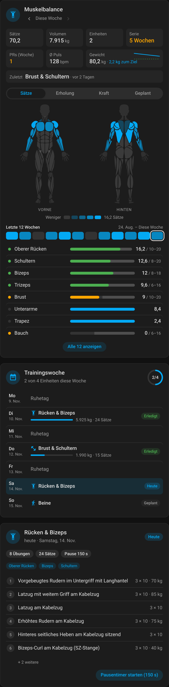
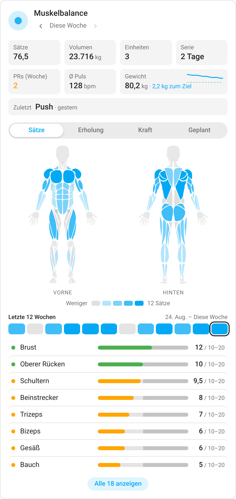
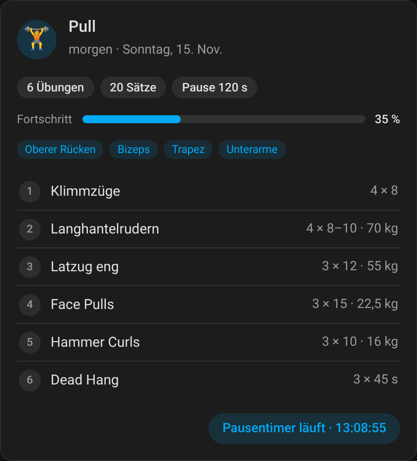

<div align="center">


# openGym for Home Assistant

**Your training in the smart home – workouts, personal records, muscle balance and training plan from your self-hosted [openGym](https://github.com/DuarteSantos8/openGym) instance.**

[](https://github.com/JImmyB0nes/OpenGym-HomeAssistant/releases/latest)
[](https://www.home-assistant.io/)
[](https://hacs.xyz/)
[](https://github.com/JImmyB0nes/OpenGym-HomeAssistant/actions/workflows/ci.yml)
[](LICENSE)

[](https://my.home-assistant.io/redirect/hacs_repository/?owner=JImmyB0nes&repository=OpenGym-HomeAssistant&category=integration)
[](https://my.home-assistant.io/redirect/config_flow_start/?domain=opengym)

<a href="#-installation--setup">Installation</a> ·
<a href="#-dashboard-cards">Cards</a> ·
<a href="#-entities--services">Entities</a> ·
<a href="#-troubleshooting">Troubleshooting</a> ·
<a href="#-faq">FAQ</a>

</div>

<table>
  <tr>
    <td width="40%" align="center"><br/><sub>Muscle, week and next-training card (dark)</sub></td>
    <td width="60%" align="center"><br/><sub>Muscle balance with stats (light)</sub><br/><br/><br/><sub>Next training with live progress</sub></td>
  </tr>
</table>

## ✨ What you get

| | |
|---|---|
| ⚡ **Real time** | Signed webhooks for *workout finished*, *new personal record* and *weigh-in* – as HA events and device triggers |
| 🔄 **Always up to date** | Polling of the openGym API (default 15 min) plus a fast revision check every 30 s |
| 🧬 **Dashboard cards** | Muscle balance with openGym's body map, training week, next workout – bundled, no extra resource needed |
| 🏋️ **Sensors** | Last workout, volume, week streak, next session, records, 1RM, weight & goal, fatigue, weekly sets per muscle |
| 💪 **Muscles** | Rest days and recovery for 14 muscle groups from openGym's exercise catalog (over 5,600 exercises, names in German/English) |
| 🗓️ **Plan** | Training plan and history as calendars; set a rest day, move a workout, day note – written back conflict-safely |
| ⏱️ **During training** | Rest-timer pushes to your devices, live progress *(admin)*, heart rate & zone from your watch |
| 🧑‍🏫 **Coach** | Trigger a review, status as sensor, accept/reject suggestions via buttons *(if your instance offers the coach)* |
| 🔐 **Secure & maintainable** | Pairing code instead of passwords, HMAC signature verification, reauth, repair hints, diagnostic data, update entity |

## 🚀 Installation & Setup

> **TL;DR:** `INTEGRATIONS=webhook` (+ `INTEGRATIONS_ALLOW_LAN=1` if HA runs in your home network) in openGym's `.env` → `docker compose up -d` → install the integration via HACS → restart → add *openGym* → enter the pairing code from **Settings → Account → "Pair mobile app"**.

Setup takes about ten minutes and has four parts: prepare openGym, sort out the addresses, install and pair the integration, add the cards. The examples consistently use these values – replace them with your own:

| What | Example |
|---|---|
| openGym in the home network | `http://192.168.123.14:8080` |
| openGym public (reverse proxy/tunnel) | `https://gym.example.com` |
| Home Assistant in the home network | `http://192.168.123.20:8123` |
| Home Assistant public (optional) | `https://ha.example.com` |

### 1. Prerequisites

- A **self-hosted openGym instance** ([DuarteSantos8/openGym](https://github.com/DuarteSantos8/openGym), Docker Compose). The phone app alone without a server is not enough, because Home Assistant needs the server's API.
- An **openGym account** on that instance that you can log in to in the browser (passkey or password). For live progress and "training in progress" it must be an **admin** account, because openGym only shares live presence with admins.
- **Home Assistant 2024.11 or newer.**
- **[HACS](https://hacs.xyz/)** (recommended) or access to the `config/custom_components` folder.

### 2. Prepare openGym (server)

The integration works without this step too, but only via **polling** (default every 15 minutes, plus a fast revision check every 30 s). With webhooks, openGym reports finished workouts, records and weigh-ins **instantly**.

**2.1 Enable webhooks.** Integrations are off by default in openGym. Without this setting, openGym hides the webhook card from everyone except admins and does not create any webhooks. Add to the `.env` next to `docker-compose.yml`:

```ini
INTEGRATIONS=webhook
```

**2.2 Allow webhooks into the home network (`INTEGRATIONS_ALLOW_LAN`).** openGym treats a webhook URL like a push endpoint: `https://` only, and never a private address. The address is checked when the connection is established, so also when a hostname resolves to a private IP. If Home Assistant runs at `http://192.168.123.20:8123`, openGym discards every delivery until you allow this:

```ini
INTEGRATIONS_ALLOW_LAN=1
```

<details>
<summary>What exactly is allowed – and what stays blocked</summary>

What the switch allows (`api/net-guard.js`):

- the home-network ranges `10.0.0.0/8`, `172.16.0.0/12`, `192.168.0.0/16`, `100.64.0.0/10` (Tailscale & Co.) and IPv6 `fc00::/7`
- **unencrypted `http://`, but only to these addresses**

What stays blocked no matter the setting:

- Loopback (`127.0.0.1`, i.e. the openGym server itself)
- Link-local (`169.254.x.x`)
- Multicast and reserved ranges
- `http://` to an internet address

Valid values are `1`, `true`, `yes` or `on`. Note: afterwards every logged-in user of your instance can have the server send requests into your home network. Only enable it on an instance whose users you trust.

</details>

<details>
<summary>More variables: <code>ALLOWED_PRIVATE_IPS</code>, <code>ORIGIN</code>/<code>RP_ID</code>, <code>WEB_PORT</code></summary>

| Variable | Purpose |
|---|---|
| `ALLOWED_PRIVATE_IPS` | Individual private addresses, ranges (`a-b`) or CIDR blocks that are additionally allowed, e.g. `192.168.123.20` or `10.0.0.0/8`. Applies to push and webhooks. This is the way to go if you want to allow *only* Home Assistant; with `INTEGRATIONS_ALLOW_LAN=1` the whole home network is open. |
| `ORIGIN` / `RP_ID` | The address you open openGym in the browser under (passkeys). Home Assistant authenticates with a bearer token and is unaffected by this. But you do have to create the pairing code in the browser under this address. |
| `WEB_PORT` | Host port of the `web` container (default `8080`), i.e. the port in the LAN URL. |

</details>

**Where to put it?** openGym's `docker-compose.yml` loads the `.env` into the `api` container via `env_file: .env`, so the `.env` is the easiest way:

```ini
# .env (next to docker-compose.yml)
INTEGRATIONS=webhook
INTEGRATIONS_ALLOW_LAN=1
```

<details>
<summary>Alternative: directly in <code>docker-compose.yml</code></summary>

Alternatively, directly on the `api` service in `docker-compose.yml`:

```yaml
services:
  api:
    environment:
      - INTEGRATIONS=webhook
      - INTEGRATIONS_ALLOW_LAN=1
```

</details>

**Apply.** A plain `docker compose restart` does **not** re-read changed environment variables. The container has to be recreated:

```bash
docker compose up -d
```

Compose detects the changed configuration and recreates the `api` container. If it doesn't get recreated: `docker compose up -d --force-recreate api`.

**Check whether it took effect:**

```bash
docker compose exec api printenv INTEGRATIONS INTEGRATIONS_ALLOW_LAN
# expected:
# webhook
# 1
```

In the openGym web app, the **Webhooks** card with **Connect** now appears under **Settings → Integrations**. A typo in `INTEGRATIONS` shows up as a warning in the log (`docker compose logs api`).

### 3. Which openGym URL Home Assistant uses

You will enter this URL later in the setup dialog. Home Assistant reads the data state from it and writes plan changes back.

| | LAN URL `http://192.168.123.14:8080` | Public URL `https://gym.example.com` |
|---|---|---|
| **Pros** | no proxy needed, fast, works without internet | encrypted, works even if HA is located elsewhere |
| **Cons** | unencrypted in the LAN; needs a static IP or DHCP reservation | depends on proxy/tunnel and DNS; Cloudflare Access or similar in front of it blocks HA |
| **When** | HA and openGym in the same network (the normal case) | HA outside, or openGym only reachable via proxy |

Notes:

- This means the **`web` container** (port `WEB_PORT`, default `8080`), not the `api` port `3000`. The API port is not published in the standard compose file.
- No trailing `/`. For an installation under a sub-path (`BASE_PATH=/gym`), include the path: `https://example.com/gym`.
- Quick test from a machine in the LAN: `curl http://192.168.123.14:8080/api/config` must return JSON containing `invite_only`. An HTML page means: wrong port or a proxy login in between.

### 4. The URL openGym uses to reach Home Assistant

Webhooks go the **other direction**: openGym's `api` container sends a `POST` to `https://<HA>/api/webhook/<id>`. The integration builds this URL from Home Assistant's network settings, under **Settings → System → Network → Home Assistant URL**. The field is only visible in **advanced mode**, which you enable in your user profile.

- **Internet**, e.g. `https://ha.example.com`: **preferred** as soon as it is set. Public HTTPS; no `INTEGRATIONS_ALLOW_LAN` needed for this.
- **Local network**, e.g. `http://192.168.123.20:8123`: used when no internet URL is set. For this, openGym needs `INTEGRATIONS_ALLOW_LAN=1` (or the IP in `ALLOWED_PRIVATE_IPS`).

The chosen URL must be reachable **from inside the openGym container**, not just from your machine:

<details>
<summary>Checklist: reachable from the container?</summary>

- Use the **IP address**. `homeassistant.local` (mDNS) usually does not resolve inside a Docker container.
- Do not use `127.0.0.1` or `localhost`, even if both run on the same host. Loopback is always blocked. Use the host's LAN IP.
- Test from the container: `docker compose exec api wget -qO- http://192.168.123.20:8123/api/` must answer with `401 Unauthorized` – that means: reachable. If `wget` is missing in the image, use `node -e "fetch('http://192.168.123.20:8123/api/').then(r=>console.log(r.status))"`.

</details>

Which URL the integration uses is shown in the setup dialog in step 6.

### 5. Install the integration

**Via HACS (recommended)** — openGym is listed in HACS, you don't need to add a custom repository.

[](https://my.home-assistant.io/redirect/hacs_repository/?owner=JImmyB0nes&repository=OpenGym-HomeAssistant&category=integration)

1. HACS → **Integrations** → **Explore** → search for *openGym* → **Download**
2. **Restart Home Assistant** (Settings → System → ⏻ → Restart Home Assistant)

<details>
<summary>If openGym doesn't show up in the search (older HACS versions)</summary>

Add the repository manually: HACS → **⋮ → Custom repositories** → `https://github.com/JImmyB0nes/OpenGym-HomeAssistant`, type **Integration** → **Add**, then *openGym* → **Download**.

</details>

<details>
<summary>Manual (without HACS)</summary>

```bash
git clone https://github.com/JImmyB0nes/OpenGym-HomeAssistant
cp -r OpenGym-HomeAssistant/custom_components/opengym <config>/custom_components/
```
Then restart as well.

</details>

### 6. Set up and pair the integration

1. **Settings → Devices & Services → Add integration → openGym** – or directly:
   [](https://my.home-assistant.io/redirect/config_flow_start/?domain=opengym)
2. Enter the **URL** from step 3, e.g. `http://192.168.123.14:8080`. The integration immediately checks `GET /api/config`.
3. **Create a pairing code.** Open the openGym web app in the browser, logged in with the account HA should see:
   **Settings → Account → "Pair mobile app"** → confirm with passkey or password ("Confirm it's you first.") → openGym shows an 8-digit code.
   - The code is valid for **5 minutes** and only once. A new code replaces the old one.
   - Create it in the **browser**. In the phone app this only works if the account has a password.
4. Enter the code in the dialog. Optionally give it a name – useful with multiple profiles.
5. Choose **webhook**:
   - **"Set up webhook automatically"** (default): the integration itself creates the webhook connection "Home Assistant" in openGym with the events `workout.finished`, `workout.pr` and `weighin.logged`, and takes over the signing secret. Steps 2 and 4 are the prerequisites. If it fails, the HA log says *"could not create the webhook connection automatically"*. The integration still works and keeps polling.
   - **Manually** (unchecked): the dialog shows the webhook URL (`…/api/webhook/<id>`). Enter it in openGym under **Settings → Integrations → Webhooks → Connect**, select the three events *Workout finished*, *New personal record* and *Weigh-in logged*, and copy the signing secret – shown **only once** – into the *Secret* field. Without a secret, deliveries are not signature-verified.
6. Verify: in HA, subscribe to the event `opengym_workout_finished` under **Developer tools → Events**. Then in openGym, open the connection under **Settings → Integrations → Webhooks** and tap **Send test event**, or run the `opengym.trigger_test_event` action in HA. An event with `"test": true` must appear. The connection's detail sheet in openGym also shows the last delivery and the last error.

### 7. Add the cards

The integration ships three cards (`custom:opengym-muscle-card`, `custom:opengym-week-card`, `custom:opengym-next-card`). No separate HACS entry needed.

- **Dashboards in UI mode (default):** the resource `/opengym/opengym-muscle-card.js?v=<version>` is registered automatically at startup and adjusted on updates. Then Dashboard → **Edit → Add card** → search for *openGym*.
- **Dashboards in YAML mode:** here the integration cannot register anything. Add the resource yourself:

  ```yaml
  # configuration.yaml
  lovelace:
    mode: yaml
    resources:
      - url: /opengym/opengym-muscle-card.js?v=0.10.1
        type: module
  ```

  Alternatively in the UI under **Settings → Dashboards → ⋮ → Resources → Add resource**, with URL `/opengym/opengym-muscle-card.js` and type *JavaScript module*. This menu item only appears in advanced mode.
- **After an update:** the card reports itself if the browser still has the old version in cache. Then hard-reload the page (Ctrl+F5). In the companion app, reset the frontend cache: **Settings → Companion App → Troubleshooting** (Android) or **Debugging** (iOS) **→ Reset frontend cache**.

## 🧬 Dashboard cards

Three cards come with the integration. They follow the HA theme (light/dark) and the HA language (de/en) and have a visual editor.

### Muscle balance – `custom:opengym-muscle-card`

openGym's real body map, overlaid with your week. Use ‹ › to page through past weeks. Clicking a muscle opens details (weekly sets, fatigue, 1RM history, exercises). Plus a 12-week heatmap and stats (sets, volume, sessions, week streak, PRs, avg heart rate, weight).

| Mode | What the card shows |
|---|---|
| **Sets** | Effective sets per muscle against the target range (10–20 & co., like in the app) |
| **Recovery** | Fresh to neglected — red means "just trained", green "not in weeks" |
| **Strength** | Best estimated 1RM per muscle (Epley) |
| **Planned** | Which muscles the next planned session would hit — plus a weekly plan bar |

<details>
<summary>Configuration</summary>

```yaml
type: custom:opengym-muscle-card
entity: sensor.opengym_muscle_balance   # default, may be omitted
body: male          # male | female
mode: sets          # sets | recovery | strength | planned
show_list: true     # muscle list with target bars
show_week: true     # week row with arrow navigation
show_heatmap: true  # 12-week heatmap
show_detail: true   # detail panel on muscle click
show_plan_week: true # weekly plan bar in planned mode
show_stats: true    # stats in the header
show_legend: true   # color legend
list_limit: 8       # rows until "Show all" (0 = all)
title: Muscle balance # custom title
accent: "#a3e635"   # custom accent color (default: HA primary color)
```

</details>

### Training week – `custom:opengym-week-card`

Plan and reality side by side: planned routine with icon, completed sessions with volume and sets.

<details>
<summary>Configuration</summary>

```yaml
type: custom:opengym-week-card
entity: sensor.opengym_muscle_balance
days: 14            # days starting Monday of this week (1–14)
title: Training week
accent: "#a3e635"
```

</details>

### Next workout – `custom:opengym-next-card`

Routine with icon, exercises with sets × reps and weight, muscle chips, live progress during the workout, and a button for the rest timer.

<details>
<summary>Configuration</summary>

```yaml
type: custom:opengym-next-card
entity: sensor.opengym_next_session   # default
max_exercises: 6        # 0 = all
show_muscles: true      # muscle chips
show_rest_button: true  # "Start rest timer" (opengym.start_rest_timer)
```

</details>

The data source is `sensor.opengym_muscle_balance` or `sensor.opengym_next_session`. All values are in their attributes and can also be used in your own cards, templates or automations.

## 📋 Entities & Services

Entity IDs are derived from the English names and the device name *openGym*. If you renamed the device, the prefix changes.

<details>
<summary><b>Sensors</b></summary>

| Entity | Shows |
|---|---|
| `sensor.opengym_last_workout` | last workout (date, volume, sets as attributes) |
| `sensor.opengym_last_personal_record` | records of the last workout |
| `sensor.opengym_last_weigh_in` | weight – a real scale sensor, for energy dashboards & co. |
| `sensor.opengym_volume_this_week` | volume this week (kg) |
| `sensor.opengym_workouts_this_week` | sessions this week |
| `sensor.opengym_workout_streak` | training days in a row |
| `sensor.opengym_week_streak` | *(0.10.1)* week streak like in openGym: consecutive weeks with training, incl. freeze (one every 4 weeks, max 2); the current week does not break the streak |
| `sensor.opengym_days_since_last_workout` | days without training – for reminders |
| `sensor.opengym_next_session` | `Push · 2026-11-16` or `Rest` |
| `sensor.opengym_total_lifted` | volume lifted ever |
| `sensor.opengym_goal_weight` | goal weight with `delta` and `at_or_below_goal` |
| `sensor.opengym_personal_records` | number of personal records, all per exercise as attribute |
| `sensor.opengym_workout_heart_rate` | avg heart rate of the last workout (if HR sets exist) |
| `sensor.opengym_estimated_1rm` | best estimated 1RM (Epley), all exercises as attribute |
| `sensor.opengym_custom_exercises` | number of custom exercises (list as attribute) |
| `sensor.opengym_muscle_fatigue` | fatigue per muscle (half-life model) as attributes |
| `sensor.opengym_weekly_training_history` | 12-week history (sets, sessions, volume) for the heatmap |
| `sensor.opengym_muscle_balance` | weekly sets per muscle, target ranges, last trained, best 1RM, PRs of the week, weight history, avg HR – as attributes for the cards |
| `sensor.opengym_live_workout_progress` | *(0.10)* progress of the ongoing workout in % (exercise x/y, sets x/y as attributes; needs admin rights) |
| `sensor.opengym_rest_timer` | *(0.10)* rest timer from HA: `idle` / `running`, end as attribute `ends_at`, remaining time `remaining` |
| `sensor.opengym_<muscle>_weekly_sets` | *(0.10)* effective sets this week per muscle – with `state_class: measurement`, so long-term statistics |
| `sensor.opengym_coach` | *(0.10, coach only)* `idle` · `queued` · `running` · `proposal`, suggestion and changes as attributes |
| `sensor.opengym_paired_watches` | *(0.10, watch feature only)* paired watches, last seen |
| `sensor.opengym_watch_heart_rate` | *(0.10)* latest heart rate from the watch (bpm). Watch sensors only exist once a watch is paired; they appear then without a restart. |
| `sensor.opengym_heart_rate_zone` | *(0.10)* HR zone 1–5 (50/60/70/80/90 % of max HR from the options) |

Additionally *(0.10)*:

- `binary_sensor.opengym_today_done` — `on` as soon as a workout or day note exists today (openGym's `nudge-check`)
- `binary_sensor.opengym_workout_reminder_due` — `on` while openGym's reminder rule would still remind today
- `button.opengym_accept_coach_proposal` / `button.opengym_reject_coach_proposal` — only if the instance offers the coach

</details>

<details>
<summary><b>Muscles, calendars & binary sensors</b></summary>

From openGym's exercise catalog (all library exercises, same weights as the app: primary muscle 1.0, secondary 0.4; custom exercises via their muscles or body part), covering 14 groups (`chest`, `deltoids`, `hamstring`, `abs`, …):

- `sensor.opengym_<group>_idle` (e.g. `sensor.opengym_chest_idle`) — days since the last session (`999` = never)
- `binary_sensor.opengym_<group>_recovering` — `on` while the group (< 2 days) is still recovering
- `binary_sensor.opengym_rest_day` — `on` when no session is planned today
- `binary_sensor.opengym_worked_out_today` / `binary_sensor.opengym_worked_out_this_week` — trained triggers for automations
- `binary_sensor.opengym_active_workout` — `on` while lifting live (with attributes: name, exercise, sets). Requires admin rights on the openGym instance. Without them, since 0.10.1 the sensor is not created at all.
- `calendar.opengym_training_plan` — weekly plan incl. day overrides
- `calendar.opengym_workout_history` — completed workouts as a calendar
- `update.opengym_opengym_instanz` — shows when the instance is behind the official release

</details>

<details>
<summary><b>Device triggers & actions (no YAML)</b></summary>

The **openGym** device offers in the automation editor:

| | |
|---|---|
| **Triggers** | Workout finished · New personal record · Weigh-in logged |
| **Action** | Log weigh-in |

</details>

<details>
<summary><b>Services</b></summary>

```yaml
action: opengym.log_weighin
data:
  weight: 80.4        # kg or lb, depending on unit
  unit: kg
  date: "2026-11-13"  # optional, default: today

action: opengym.trigger_test_event
data:
  event_type: workout.finished
```

New in **0.10**:

```yaml
# Rest timer: openGym sends the push to your devices that rings when it expires
action: opengym.start_rest_timer
data:
  seconds: 90          # optional, default: your rest time from openGym (otherwise 90)
action: opengym.cancel_rest_timer

# Edit the plan (writes with baseRev; on 409 the change is re-applied to the new
# state, up to 4 attempts)
action: opengym.set_rest_day
data:
  date: "2026-11-18"   # optional, default: today; clear: true reverts the day override
action: opengym.move_day
data:
  from_date: "2026-11-18"
  to_date: "2026-11-19"
action: opengym.add_day_note
data:
  tag: sick            # sick | travel | rest | injured — today or earlier only
  text: "Flu"

# Coach review (answer arrives as proposal → sensor.opengym_coach + buttons)
action: opengym.coach_review
data:
  note: "Knee twinges, fewer squats"
  lang: en
```

Multiple openGym profiles? Every service optionally takes `entry_id`.

```yaml
# Workout history with summary — ideal for weekly reports
action: opengym.get_workout_history
data:
  days: 7
response_variable: history
# -> history.summary: { total_workouts, total_volume, workout_days, avg_duration_min, unit }

# Routines with exercises — e.g. for dashboard selection
action: opengym.get_routines
response_variable: routines
```

</details>

<details>
<summary><b>Events</b></summary>

For those who want to know exactly:

| openGym event | HA event |
|---|---|
| `workout.finished` | `opengym_workout_finished` |
| `workout.pr` | `opengym_personal_record` |
| `weighin.logged` | `opengym_weighin_logged` |

</details>

<details>
<summary><b>Example automations</b></summary>

**Lights on when the workout is done:**

```yaml
automation:
  - alias: "Workout done"
    triggers:
      - trigger: event
        event_type: opengym_workout_finished
    actions:
      - action: light.turn_on
        target:
          entity_id: light.living_room
        data:
          brightness: 200
```

**Reminder when nothing happened for too long:**

```yaml
automation:
  - alias: "Back to the gym"
    triggers:
      - trigger: numeric_state
        entity_id: sensor.opengym_days_since_last_workout
        above: 4
    actions:
      - action: notify.notify
        data:
          message: "No training for 5 days. Next session: {{ states('sensor.opengym_next_session') }}"
```

**Write the scale back automatically:**

```yaml
automation:
  - alias: "Morning scale"
    triggers:
      - trigger: state
        entity_id: sensor.smart_scale_weight
    actions:
      - action: opengym.log_weighin
        data:
          weight: "{{ trigger.to_state.state | float }}"
```

</details>

## 🩺 Troubleshooting

| Problem | Cause | Solution |
|---|---|---|
| **`cannot_connect`** during setup | wrong URL or port (`3000` instead of `8080`), proxy login or HTML page instead of API, invalid HTTPS certificate, firewall | `curl <URL>/api/config` from the HA host must return JSON; use the LAN URL of the `web` container; exempt `/api/*` from Cloudflare Access or similar |
| **`invalid_code`** | code older than 5 minutes, already used, replaced by a newer one, or created for a different instance | create a new code under *Settings → Account → Pair mobile app* and enter it right away; use the same instance as in the URL |
| **Webhooks don't arrive** (data only after polling) | `INTEGRATIONS=webhook` missing; HA URL private without `INTEGRATIONS_ALLOW_LAN=1`; `.local` name or `127.0.0.1` as HA URL; container not recreated after `.env` change | check steps 2 and 4; `docker compose up -d`; `docker compose exec api printenv INTEGRATIONS_ALLOW_LAN`; open the webhook connection's detail sheet in openGym and read the last error (`refusing to connect` means: address blocked) |
| Webhook error `ECONNREFUSED` or timeout | HA port blocked by the firewall, or openGym in a docker network without route into the LAN | open port `8123` for the openGym host; test from the container (step 4); with `network_mode`/custom networks check the route |
| HA reports a **repair** "Webhook deliveries failed" | openGym could not deliver multiple times | fix the cause as above, then confirm the repair. The failed deliveries are re-queued. |
| **Cards missing** in the card picker | HA not restarted after installation; dashboard in YAML mode; browser cache | restart; add the resource manually (step 7); Ctrl+F5 or clear the app's frontend cache |
| Card shows "Configuration error" / *Custom element doesn't exist* | resource missing or stale cache | as above; *Resources* must list `/opengym/opengym-muscle-card.js?v=…` |
| Entities **"Unavailable"** | openGym unreachable, after multiple failures a repair appears additionally; session expired, then HA starts re-authentication | check URL and reachability; when asked to *re-authenticate*, enter a new pairing code. Since 0.10.1 watch sensors are only created once a watch is paired, and live sensors only with an admin account. The integration removes stale entries itself. |
| Live progress / "training in progress" missing | account is not an admin | openGym only exposes live presence to admins; pair with an admin account |

## ❓ FAQ

<details>
<summary><b>Do I need webhooks?</b></summary>

No. Without webhooks the integration polls (default every 15 minutes, plus the fast check every 30 s). Webhooks make *workout finished*, *record* and *weigh-in* visible instantly and trigger automations without delay.
</details>

<details>
<summary><b>Why are live progress and "training in progress" missing?</b></summary>

openGym only shares live presence with admin accounts (`/api/admin/users`). Without admin rights the integration does not create these entities at all.
</details>

<details>
<summary><b>Why don't I see watch or coach entities?</b></summary>

Watch sensors only appear once a watch is paired, then without a restart. Coach entities only exist if the instance offers the coach. If the coach is enabled later, reload the integration once.
</details>

<details>
<summary><b>Can I accept coach proposals in HA?</b></summary>

Simple values (sets, reps, rep range, seconds, progression, warm-up, routine name) are applied by Home Assistant itself, including an undo snapshot for the app. Proposals with structural changes (swap exercise, weekly plan, new plan) must be accepted in the app; the accept button tells you so. Rejecting always works.
</details>

<details>
<summary><b>Why does the rest timer only know timers from HA?</b></summary>

openGym keeps timers only in memory and does not expose them. `sensor.opengym_rest_timer` therefore shows timers started with `opengym.start_rest_timer`: `idle` or `running`, with end time in `ends_at`.
</details>

<details>
<summary><b>Multiple openGym profiles?</b></summary>

Add the integration multiple times, one pairing code per profile. Every service optionally takes `entry_id`, and the cards query the right entry.
</details>

<details>
<summary><b>What can be configured?</b></summary>

Via the integration's **options**: polling interval (default 15 min), fast check (default 30 s, `0` = off) and maximum heart rate for the HR zones (default 190).
</details>

<details>
<summary><b>How secure is this?</b></summary>

- The **webhook URL is the secret** — it is unique, long and unguessable.
- With a stored **signing secret** the integration verifies every call: `X-OpenGym-Signature` as HMAC-SHA256 over `t=<timestamp>.<body>`, 5-minute window, compared timing-safe. Non-matching deliveries are discarded.
- **No passwords:** access runs via a pairing code, the token is renewed automatically.
- openGym delivers via **HTTPS** only, or `http://` into the LAN if `INTEGRATIONS_ALLOW_LAN=1` is set. Deliveries come "at least once"; you can detect duplicates by `event_id`.
</details>

## 🙏 Credits & License

- **[openGym](https://github.com/DuarteSantos8/openGym)** by DuarteSantos8 (AGPL-3.0). Logo, body-map geometry and exercise catalog come from the openGym project; details and licenses in [NOTICE.md](NOTICE.md).
- Body map based on [MuscleMap](https://github.com/melihcolpan/MuscleMap) (MIT).
- This integration: **[MIT](LICENSE)**. Not an official openGym or Home Assistant project.
