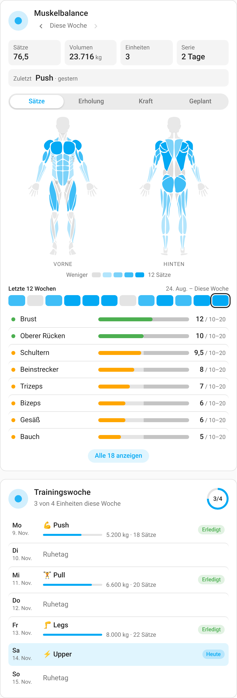
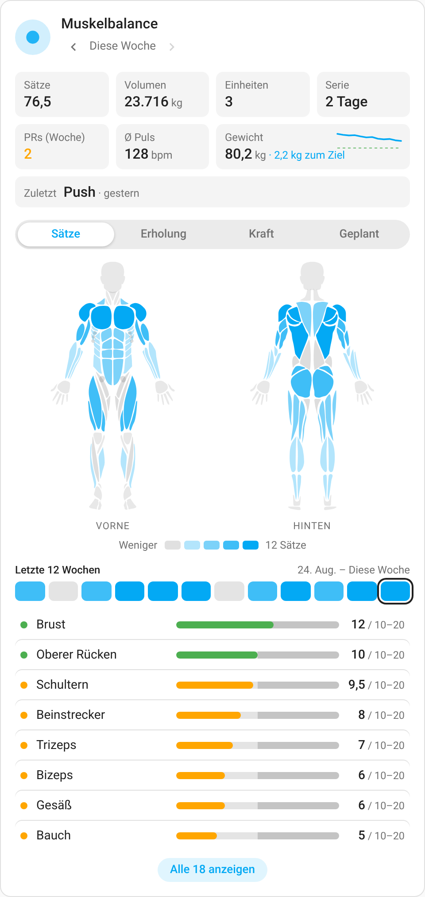
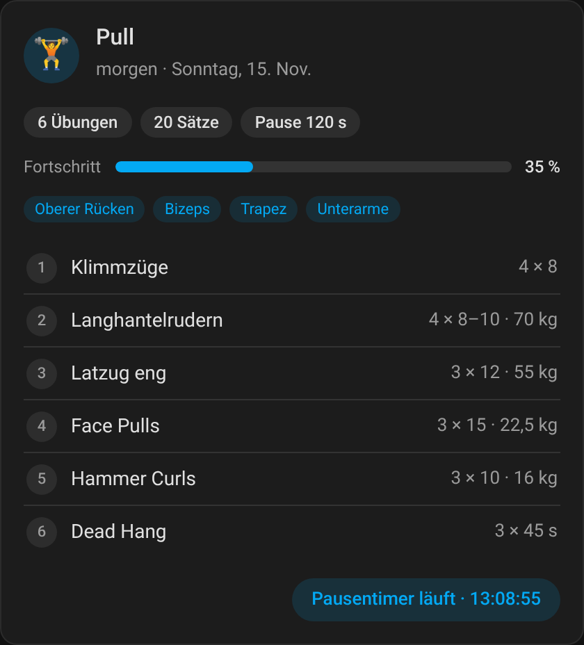
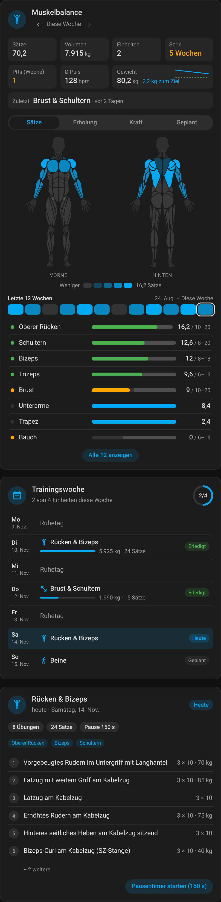

<div align="center">


# openGym für Home Assistant

**Trainingsdaten live im Smart Home.**

[](https://github.com/JImmyB0nes/OpenGym-HomeAssistant/releases)
[](LICENSE)
[](https://github.com/DuarteSantos8/openGym)

</div>

Diese Integration verbindet eine [**openGym**](https://github.com/DuarteSantos8/openGym)-Instanz mit Home Assistant — dein Workout, dein Streak und deine Fortschritte lösen dann Automationen aus, statt in der App zu liegen.

Sie funktioniert zweigleisig:

| | |
|---|---|
| ⚡ **Echtzeit** | openGym sendet signierte Webhooks bei *Workout beendet*, *neuem Rekord* und *Wiegen* |
| 🔄 **Im Hintergrund** | Pollen der openGym-API liefert Plan, Muskelabdeckung, Bestgewichte und Streaks |

## Features

- 🏋️ **15 Stamm-Sensoren** — letztes Workout, Wochen-Volumen, Streak, nächste Einheit, geschätztes 1RM u.v.m.
- 🧬 **Muskel-Karte im Dashboard** — gebündelte Lovelace-Card mit echter openGym-Körperkarte, Wochen-Sets gegen Zielbereiche, Erholung und Kraft
- ✅ **"Heute / diese Woche trainiert"** — die meistgenutzten Trigger für Automationen
- 📆 **Workout-Verlauf** — abgeschlossene Workouts als Kalender-Events für die native Calendar-Card
- 💪 **28 Muskel-Sensoren** — Idle-Tage und Erholungsstatus für 14 Muskelgruppen, aus openGyms echtem Übungskatalog (über 5.600 Übungen)
- 🟢 **Live-Training** — `binary_sensor.opengym_active_workout` zeigt, ob gerade wirklich gehoben wird
- 📅 **Kalender** — der Wochentagsplan als Entität, die jeder Karten- und Kalender-Card versteht
- 🔔 **Device-Trigger & -Actions** — Automationen ohne YAML: *„Wenn das openGym-Gerät ein Workout abschließt …“*
- ⚖️ **Zwei-Wege** — `log_weighin` schreibt die Waage zurück in openGym, `trigger_test_event` testet die Leitung
- 🪄 **Auto-Webhook** — beim Koppeln richtet die Integration die Webhook-Verbindung in openGym gleich selbst ein
- 🔐 **Abgesichert** — HMAC-SHA256-Signaturprüfung, Pairing-Code statt Passwort, automatische Reauth bei abgelegtem Token
- 🩺 **Diagnostik & Reparaturen** — Fehler landen als klickbarer Reparatur-Hinweis im HA-UI, Konfig-Dump für Issue-Reports
- ⬆️ **Update-Anzeige** — `update.opengym_*` zeigt, ob die Instanz hinter dem offiziellen Release steht
- ⚡ **Schnellprüfung** *(0.10)* — alle 30 s nur die Revision (`/api/data/rev`, ein paar Bytes); das ganze Dokument wird nur bei Änderungen geladen
- ⏱️ **Pausentimer** *(0.10)* — `opengym.start_rest_timer` schickt deinen Geräten den Pausen-Push, Live-Fortschritt als Sensor
- 🧑‍🏫 **Coach** *(0.10)* — Review anstoßen, Status als Sensor, Vorschläge per Button annehmen/ablehnen
- 🗓️ **Plan bearbeiten** *(0.10)* — Ruhetag setzen, Training verschieben, Tagesnotiz (krank/unterwegs …) mit konfliktsicherem Schreiben
- ⌚ **Uhr** *(0.10)* — Herzfrequenz und HF-Zone von der gekoppelten Uhr
- 📈 **Langzeitstatistik** *(0.10)* — Wochen-Sätze je Muskel als Statistik-Sensoren für Verlaufsgraphen

## Installation & Einrichtung

Die Einrichtung dauert etwa zehn Minuten und hat vier Teile: openGym vorbereiten, die Adressen klären, die Integration installieren und koppeln, die Karten einbinden. Die Beispiele verwenden durchgehend diese Werte, ersetze sie durch deine eigenen:

| Was | Beispiel |
|---|---|
| openGym im Heimnetz | `http://192.168.123.14:8080` |
| openGym öffentlich (Reverse Proxy/Tunnel) | `https://gym.example.de` |
| Home Assistant im Heimnetz | `http://192.168.123.20:8123` |
| Home Assistant öffentlich (optional) | `https://ha.example.de` |

### 1. Voraussetzungen

- Eine **selbst gehostete openGym-Instanz** ([DuarteSantos8/openGym](https://github.com/DuarteSantos8/openGym), Docker Compose). Die reine Handy-App ohne Server reicht nicht, denn Home Assistant braucht die API des Servers.
- Ein **openGym-Konto** auf dieser Instanz, mit dem du dich im Browser anmelden kannst (Passkey oder Passwort). Für Live-Fortschritt und „Training läuft“ muss es ein **Admin**-Konto sein, denn openGym teilt Live-Präsenz nur mit Admins.
- **Home Assistant 2024.11 oder neuer.**
- **[HACS](https://hacs.xyz/)** (empfohlen) oder Zugriff auf den Ordner `config/custom_components`.

### 2. openGym vorbereiten (Server)

Ohne diesen Schritt funktioniert die Integration auch, allerdings nur per **Polling** (Standard alle 15 Minuten, dazu eine schnelle Revisionsprüfung alle 30 s). Mit Webhooks meldet openGym abgeschlossene Workouts, Rekorde und Wiegungen **sofort**.

**2.1 Webhooks einschalten.** Integrationen sind in openGym standardmäßig aus. Ohne Einstellung blendet openGym die Webhook-Karte für alle außer Admins aus und legt keine Webhooks an. Trage in die `.env` neben der `docker-compose.yml` ein:

```ini
INTEGRATIONS=webhook
```

**2.2 Webhooks ins Heimnetz erlauben (`INTEGRATIONS_ALLOW_LAN`).** openGym behandelt eine Webhook-URL wie einen Push-Endpunkt: nur `https://` und nie eine private Adresse. Die Adresse wird beim Verbindungsaufbau geprüft, also auch dann, wenn ein Hostname auf eine private IP auflöst. Läuft Home Assistant unter `http://192.168.123.20:8123`, verwirft openGym jede Zustellung, bis du das freigibst:

```ini
INTEGRATIONS_ALLOW_LAN=1
```

Was der Schalter freigibt (`api/net-guard.js`):

- die Heimnetz-Bereiche `10.0.0.0/8`, `172.16.0.0/12`, `192.168.0.0/16`, `100.64.0.0/10` (Tailscale & Co.) und IPv6 `fc00::/7`
- **unverschlüsseltes `http://`, aber nur zu diesen Adressen**

Was gesperrt bleibt, egal was eingestellt ist:

- Loopback (`127.0.0.1`, also der openGym-Server selbst)
- Link-Local (`169.254.x.x`)
- Multicast und reservierte Bereiche
- `http://` zu einer Internet-Adresse

Gültige Werte sind `1`, `true`, `yes` oder `on`. Beachte: Danach kann jeder angemeldete Nutzer deiner Instanz den Server Anfragen in dein Heimnetz schicken lassen. Schalte es also nur auf einer Instanz ein, deren Nutzern du vertraust.

**Weitere Variablen, die hier eine Rolle spielen:**

| Variable | Wofür |
|---|---|
| `ALLOWED_PRIVATE_IPS` | Einzelne private Adressen, Bereiche (`a-b`) oder CIDR-Blöcke, die zusätzlich erlaubt sind, z. B. `192.168.123.20` oder `10.0.0.0/8`. Gilt für Push und Webhooks. Das ist der Weg, wenn du *nur* Home Assistant freigeben willst; mit `INTEGRATIONS_ALLOW_LAN=1` ist das ganze Heimnetz offen. |
| `ORIGIN` / `RP_ID` | Die Adresse, unter der du openGym im Browser öffnest (Passkeys). Home Assistant meldet sich mit einem Bearer-Token an und ist davon nicht betroffen. Den Kopplungscode musst du aber im Browser unter dieser Adresse erzeugen. |
| `WEB_PORT` | Host-Port des `web`-Containers (Standard `8080`), also der Port in der LAN-URL. |

**Wohin damit?** Die `docker-compose.yml` von openGym lädt die `.env` mit `env_file: .env` in den `api`-Container. Die `.env` ist deshalb der einfachste Weg:

```ini
# .env (neben docker-compose.yml)
INTEGRATIONS=webhook
INTEGRATIONS_ALLOW_LAN=1
```

Alternativ direkt am `api`-Dienst in der `docker-compose.yml`:

```yaml
services:
  api:
    environment:
      - INTEGRATIONS=webhook
      - INTEGRATIONS_ALLOW_LAN=1
```

**Übernehmen.** Ein einfacher `docker compose restart` liest geänderte Umgebungsvariablen **nicht** neu ein. Der Container muss neu erstellt werden:

```bash
docker compose up -d
```

Compose erkennt die geänderte Konfiguration und erstellt den `api`-Container neu. Wenn er sich nicht neu erstellt: `docker compose up -d --force-recreate api`.

**Prüfen, ob es wirkt:**

```bash
docker compose exec api printenv INTEGRATIONS INTEGRATIONS_ALLOW_LAN
# erwartet:
# webhook
# 1
```

In der openGym-Web-App erscheint unter **Einstellungen → Integrationen** jetzt die Karte **Webhooks** mit **Verbinden**. Ein Tippfehler in `INTEGRATIONS` steht als Warnung im Log (`docker compose logs api`).

### 3. Welche openGym-URL Home Assistant benutzt

Diese URL trägst du später im Einrichtungsdialog ein. Home Assistant liest darüber den Datenstand und schreibt Planänderungen zurück.

| | LAN-URL `http://192.168.123.14:8080` | Öffentliche URL `https://gym.example.de` |
|---|---|---|
| **Vorteile** | kein Proxy nötig, schnell, funktioniert ohne Internet | verschlüsselt, funktioniert auch, wenn HA woanders steht |
| **Nachteile** | unverschlüsselt im LAN; feste IP bzw. DHCP-Reservierung nötig | hängt an Proxy/Tunnel und DNS; Cloudflare Access o. Ä. davor blockiert HA |
| **Wann** | HA und openGym im selben Netz (Normalfall) | HA außerhalb oder openGym nur per Proxy erreichbar |

Hinweise:

- Gemeint ist der **`web`-Container** (Port `WEB_PORT`, Standard `8080`), nicht der `api`-Port `3000`. Der API-Port ist in der Standard-Compose-Datei nicht veröffentlicht.
- Ohne abschließenden `/`. Bei einer Installation unter einem Unterpfad (`BASE_PATH=/gym`) gehört der Pfad dazu: `https://example.de/gym`.
- Schnelltest von einem Rechner im LAN: `curl http://192.168.123.14:8080/api/config` muss JSON mit `invite_only` liefern. Eine HTML-Seite heißt: falscher Port oder ein Proxy-Login dazwischen.

### 4. Die URL, unter der openGym Home Assistant erreicht

Webhooks gehen in die **andere Richtung**: Der `api`-Container von openGym schickt einen `POST` an `https://<HA>/api/webhook/<id>`. Die Integration baut diese URL aus den Netzwerk-Einstellungen von Home Assistant, unter **Einstellungen → System → Netzwerk → Home-Assistant-URL**. Das Feld ist nur im **erweiterten Modus** sichtbar, den du im Benutzerprofil einschaltest.

- **Internet**, z. B. `https://ha.example.de`: wird **bevorzugt**, sobald es gesetzt ist. Öffentliches HTTPS, dafür ist kein `INTEGRATIONS_ALLOW_LAN` nötig.
- **Lokales Netzwerk**, z. B. `http://192.168.123.20:8123`: wird genommen, wenn keine Internet-URL gesetzt ist. Dafür braucht openGym `INTEGRATIONS_ALLOW_LAN=1` (oder die IP in `ALLOWED_PRIVATE_IPS`).

Die gewählte URL muss **aus dem openGym-Container heraus** erreichbar sein, nicht nur von deinem Rechner aus:

- Nimm die **IP-Adresse**. `homeassistant.local` (mDNS) löst im Docker-Container meist nicht auf.
- Nimm nicht `127.0.0.1` oder `localhost`, auch wenn beides auf demselben Host läuft. Loopback ist immer gesperrt. Nimm die LAN-IP des Hosts.
- Probe aus dem Container: `docker compose exec api wget -qO- http://192.168.123.20:8123/api/` muss mit `401` antworten, das heißt erreichbar. Fehlt `wget` im Image, nimm `node -e "fetch('http://192.168.123.20:8123/api/').then(r=>console.log(r.status))"`.

Welche URL die Integration verwendet, zeigt der Einrichtungsdialog in Schritt 6 an.

### 5. Integration installieren

**Per HACS (empfohlen)**

[![HACS openGym][hacs-shield]](https://my.home-assistant.io/redirect/hacs_repository/?owner=JImmyB0nes&repository=OpenGym-HomeAssistant&category=integration)

1. HACS → **⋮ → Benutzerdefinierte Repositories** → `https://github.com/JImmyB0nes/OpenGym-HomeAssistant`, Typ **Integration** → **Hinzufügen**
2. *openGym* suchen → **Herunterladen**
3. **Home Assistant neu starten** (Einstellungen → System → ⏻ → Home Assistant neu starten)

**Manuell**

```bash
git clone https://github.com/JImmyB0nes/OpenGym-HomeAssistant
cp -r OpenGym-HomeAssistant/custom_components/opengym <config>/custom_components/
```

Danach ebenfalls neu starten.

### 6. Integration einrichten und koppeln

1. **Einstellungen → Geräte & Dienste → Integration hinzufügen → openGym**
2. **URL** aus Schritt 3 eintragen, z. B. `http://192.168.123.14:8080`. Die Integration prüft sofort `GET /api/config`.
3. **Kopplungscode erzeugen.** Öffne die openGym-Web-App im Browser, angemeldet mit dem Konto, das HA sehen soll:
   **Einstellungen → Konto → „Mobile App koppeln“** → mit Passkey oder Passwort bestätigen („Bestätige zuerst, dass du es bist.“) → openGym zeigt einen 8-stelligen Code.
   - Der Code gilt **5 Minuten** und nur einmal. Ein neuer Code ersetzt den alten.
   - Erzeuge ihn im **Browser**. In der Handy-App klappt das nur, wenn das Konto ein Passwort hat.
4. Den Code im Dialog eintragen. Optional einen Namen vergeben, das ist sinnvoll bei mehreren Profilen.
5. **Webhook** wählen:
   - **„Webhook automatisch einrichten“** (Standard): Die Integration legt in openGym selbst die Webhook-Verbindung „Home Assistant“ mit den Events `workout.finished`, `workout.pr` und `weighin.logged` an und übernimmt das Signing Secret. Voraussetzung sind Schritt 2 und Schritt 4. Klappt es nicht, steht im HA-Log *„could not create the webhook connection automatically“*. Die Integration läuft trotzdem und pollt weiter.
   - **Manuell** (Haken aus): Der Dialog zeigt die Webhook-URL (`…/api/webhook/<id>`). Trage sie in openGym unter **Einstellungen → Integrationen → Webhooks → Verbinden** ein, wähle die drei Ereignisse *Training beendet*, *Neuer persönlicher Rekord* und *Wiegen erfasst* und kopiere das Signing Secret, das **nur einmal** angezeigt wird, ins Feld *Secret*. Ohne Secret werden Zustellungen nicht signaturgeprüft.
6. Kontrolle: In HA unter **Entwicklerwerkzeuge → Ereignisse** das Ereignis `opengym_workout_finished` abonnieren. Dann in openGym unter **Einstellungen → Integrationen → Webhooks** die Verbindung öffnen und **Test-Ereignis senden** antippen, oder in HA die Aktion `opengym.trigger_test_event` ausführen. Es muss ein Ereignis mit `"test": true` erscheinen. Das Blatt der Verbindung in openGym zeigt auch die letzte Zustellung und den letzten Fehler.

### 7. Karten einbinden

Die Integration bringt drei Karten mit (`custom:opengym-muscle-card`, `custom:opengym-week-card`, `custom:opengym-next-card`). Es ist kein eigener HACS-Eintrag nötig.

- **Dashboards im UI-Modus (Standard):** Die Ressource `/opengym/opengym-muscle-card.js?v=<Version>` wird beim Start automatisch registriert und bei Updates angepasst. Danach Dashboard → **Bearbeiten → Karte hinzufügen** → nach *openGym* suchen.
- **Dashboards im YAML-Modus:** Hier kann die Integration nichts eintragen. Füge die Ressource selbst hinzu:

  ```yaml
  # configuration.yaml
  lovelace:
    mode: yaml
    resources:
      - url: /opengym/opengym-muscle-card.js?v=0.10.1
        type: module
  ```

  Alternativ in der UI unter **Einstellungen → Dashboards → ⋮ → Ressourcen → Ressource hinzufügen**, mit URL `/opengym/opengym-muscle-card.js` und Typ *JavaScript-Modul*. Dieser Menüpunkt erscheint nur im erweiterten Modus.
- **Nach einem Update:** Die Karte meldet selbst, wenn der Browser noch die alte Version im Cache hat. Dann die Seite hart neu laden (Strg+F5). In der Companion-App den Frontend-Cache zurücksetzen: **Einstellungen → Companion App → Fehlerbehebung** (Android) bzw. **Debugging** (iOS) **→ Frontend-Cache zurücksetzen**.

### 8. Fehlerbehebung

| Problem | Ursache | Lösung |
|---|---|---|
| **`cannot_connect`** („nicht erreichbar“) beim Einrichten | falsche URL oder Port (`3000` statt `8080`), Proxy-Login oder HTML-Seite statt API, HTTPS-Zertifikat ungültig, Firewall | `curl <URL>/api/config` vom HA-Host aus muss JSON liefern; LAN-URL des `web`-Containers nehmen; Cloudflare Access o. Ä. für `/api/*` ausnehmen |
| **`invalid_code`** („Code falsch oder abgelaufen“) | Code älter als 5 Minuten, schon benutzt, durch einen neueren ersetzt, oder für eine andere Instanz erzeugt | neuen Code unter *Einstellungen → Konto → Mobile App koppeln* erzeugen und sofort eintragen; dieselbe Instanz wie in der URL verwenden |
| **Webhooks kommen nicht an** (Daten erst nach dem Poll) | `INTEGRATIONS=webhook` fehlt; HA-URL privat ohne `INTEGRATIONS_ALLOW_LAN=1`; `.local`-Name oder `127.0.0.1` als HA-URL; Container nach `.env`-Änderung nicht neu erstellt | Schritt 2 und 4 prüfen; `docker compose up -d`; `docker compose exec api printenv INTEGRATIONS_ALLOW_LAN`; in openGym das Blatt der Webhook-Verbindung öffnen und den letzten Fehler lesen (`refusing to connect` heißt: Adresse gesperrt) |
| Webhook-Fehler `ECONNREFUSED` oder Timeout | HA-Port von der Firewall gesperrt, oder openGym in einem Docker-Netz ohne Route ins LAN | Port `8123` für den openGym-Host freigeben; Probe aus dem Container (Schritt 4); bei `network_mode`/eigenen Netzen die Route prüfen |
| HA meldet eine **Reparatur** „Webhook-Zustellungen fehlgeschlagen“ | openGym konnte mehrfach nicht zustellen | Ursache wie oben beheben, dann die Reparatur bestätigen. Die fehlgeschlagenen Zustellungen werden neu eingereiht. |
| **Karten fehlen** im Karten-Dialog | HA nach der Installation nicht neu gestartet; Dashboard im YAML-Modus; Browser-Cache | neu starten; Ressource manuell eintragen (Schritt 7); Strg+F5 bzw. Frontend-Cache der App leeren |
| Karte zeigt „Konfigurationsfehler“ / *Custom element doesn't exist* | Ressource fehlt oder alter Cache | wie oben; unter *Ressourcen* muss `/opengym/opengym-muscle-card.js?v=…` stehen |
| **Entitäten „Nicht verfügbar“** | openGym nicht erreichbar, nach mehreren Fehlschlägen erscheint zusätzlich eine Reparatur; Sitzung abgelaufen, dann startet HA eine erneute Authentifizierung | URL und Erreichbarkeit prüfen; bei *Erneut authentifizieren* einen neuen Kopplungscode eingeben. Seit 0.10.1 werden Uhr-Sensoren erst angelegt, wenn eine Uhr gekoppelt ist, und Live-Sensoren nur mit Admin-Konto. Alte Einträge entfernt die Integration selbst. |
| Live-Fortschritt / „Training läuft“ fehlt | Konto ist kein Admin | openGym gibt Live-Präsenz nur an Admins heraus; mit einem Admin-Konto koppeln |

## Was die Integration anlegt

### Sensoren

| Entität | Anzeigen |
|---|---|
| `sensor.opengym_last_workout` | letztes Workout (Datum, Volumen, Sätze als Attribute) |
| `sensor.opengym_last_record` | Rekorde des letzten Workouts |
| `sensor.opengym_last_weighin` | Gewicht — echter Wiegesensor, für Energie-Dashboard & Co. |
| `sensor.opengym_week_volume` | Volumen dieser Woche (kg) |
| `sensor.opengym_week_workouts` | Einheiten dieser Woche |
| `sensor.opengym_streak` | Trainingstage in Folge |
| `sensor.opengym_week_streak` | *(0.10.1)* Wochen-Serie wie in openGym: Wochen in Folge mit Training, inkl. Freeze (alle 4 Wochen einer, max. 2); die laufende Woche bricht die Serie nicht |
| `sensor.opengym_days_since_workout` | Tage ohne Training — für Erinnerungen |
| `sensor.opengym_next_session` | `Push · 2026-11-16` oder `Rest` |
| `sensor.opengym_total_lifting` | jemals gehobenes Volumen |
| `sensor.opengym_goal_weight` | Zielgewicht mit `delta` und `at_or_below_goal` |
| `sensor.opengym_personal_records` | Anzahl Bestgewichte, alle je Übung als Attribut |
| `sensor.opengym_workout_heart_rate` | Ø Puls des letzten Workouts (wenn HF-Sätze vorhanden) |
| `sensor.opengym_best_one_rm` | bestes geschätztes 1RM (Epley), alle Übungen als Attribut |
| `sensor.opengym_custom_exercises` | Anzahl eigener Übungen (Liste als Attribut) |
| `sensor.opengym_muscle_balance` | Wochen-Sets je Muskel, Zielbereiche, zuletzt trainiert, bestes 1RM, PRs der Woche, Gewichtsverlauf, Ø Puls — als Attribute für die Karten |
| `sensor.opengym_live_workout_progress` | *(0.10)* Fortschritt des laufenden Trainings in % (Übung x/y, Sätze x/y als Attribute; braucht Admin-Rechte) |
| `sensor.opengym_rest_timer` | *(0.10)* Pausentimer aus HA: `idle` (Bereit) / `running` (Läuft), Ende als Attribut `ends_at`, Restzeit `remaining` |
| `sensor.opengym_<muskel>_weekly_sets` | *(0.10)* effektive Sätze dieser Woche je Muskel — mit `state_class: measurement`, also Langzeitstatistik |
| `sensor.opengym_coach` | *(0.10, nur mit Coach)* `idle` · `queued` · `running` · `proposal`, Vorschlag und Änderungen als Attribute |
| `sensor.opengym_paired_watches` | *(0.10, nur mit Uhr-Funktion)* gekoppelte Uhren, zuletzt gesehen |
| `sensor.opengym_watch_heart_rate` | *(0.10)* neueste Herzfrequenz von der Uhr (bpm). Uhr-Sensoren gibt es erst, sobald eine Uhr gekoppelt ist; sie erscheinen dann ohne Neustart. |
| `sensor.opengym_heart_rate_zone` | *(0.10)* HF-Zone 1–5 (50/60/70/80/90 % der Max-HF aus den Optionen) |

Außerdem *(0.10)*:

- `binary_sensor.opengym_today_done` — `on`, sobald heute ein Workout oder eine Tagesnotiz existiert (openGyms `nudge-check`)
- `binary_sensor.opengym_workout_reminder_due` — `on`, solange openGyms Erinnerungsregel heute noch erinnern würde
- `button.opengym_accept_coach_proposal` / `button.opengym_reject_coach_proposal` — nur, wenn die Instanz den Coach anbietet

### Muskeln & Erholung

Aus openGyms Übungskatalog (alle Bibliotheksübungen, dieselben Gewichte wie die App: Hauptmuskel 1,0, Hilfsmuskeln 0,4; eigene Übungen über ihre Muskeln bzw. Körperpartie), abgedeckt 14 Gruppen (`chest`, `deltoids`, `hamstring`, `abs`, …):

- `sensor.opengym_muscle_<gruppe>` — Tage seit der letzten Einheit (`999` = noch nie)
- `binary_sensor.opengym_muscle_<gruppe>_recovering` — `on`, solange die Gruppe (< 2 Tage) noch erholt
- `binary_sensor.opengym_rest_day` — `on`, wenn heute keine Einheit geplant ist
- `binary_sensor.opengym_worked_out_today` / `_this_week` — Trainiert-Trigger für Automationen
- `binary_sensor.opengym_active_workout` — `on`, solange live gehoben wird (mit Attributen: Name, Übung, Sätze). Benötigt Admin-Rechte auf der openGym-Instanz. Ohne sie wird der Sensor seit 0.10.1 gar nicht erst angelegt.
- `calendar.opengym_training_plan` — Wochenplan inkl. Tages-Overrides
- `calendar.opengym_workout_history` — abgeschlossene Workouts als Kalender
- `update.opengym_open_gym_instanz` — zeigt an, wenn die Instanz hinter dem offiziellen Release steht

### Automationen ohne YAML

Das Gerät **openGym** bietet im Automation-Editor:

| | |
|---|---|
| **Auslöser** | Workout abgeschlossen · Neuer persönlicher Rekord · Wiegewägung erfasst |
| **Aktion** | Wiegewägung protokollieren |

### Services

```yaml
action: opengym.log_weighin
data:
  weight: 80.4        # kg oder lb, je nach unit
  unit: kg
  date: "2026-11-13"  # optional, Standard: heute

action: opengym.trigger_test_event
data:
  event_type: workout.finished
```

Neu in **0.10**:

```yaml
# Pausentimer: openGym schickt deinen Geräten den Push, der nach Ablauf klingelt
action: opengym.start_rest_timer
data:
  seconds: 90          # optional, Standard: deine Pausenzeit aus openGym (sonst 90)
action: opengym.cancel_rest_timer

# Plan bearbeiten (schreibt mit baseRev; bei 409 wird die Änderung auf den neuen Stand
# erneut angewendet, bis zu 4 Versuche)
action: opengym.set_rest_day
data:
  date: "2026-11-18"   # optional, Standard: heute; clear: true nimmt die Tagesänderung zurück
action: opengym.move_day
data:
  from_date: "2026-11-18"
  to_date: "2026-11-19"
action: opengym.add_day_note
data:
  tag: sick            # sick | travel | rest | injured — nur heute oder früher
  text: "Grippe"

# Coach-Review (Antwort kommt als Vorschlag → sensor.opengym_coach + Buttons)
action: opengym.coach_review
data:
  note: "Knie zwickt, weniger Kniebeugen"
  lang: de
```

Mehrere openGym-Profile? Jeder Service nimmt optional `entry_id`.

### Antwort-Services (read-only, für Vorlagen und Skripte)

```yaml
# Workout-Verlauf mit Summary — ideal für Wochenberichte
action: opengym.get_workout_history
data:
  days: 7
response_variable: history
# -> history.summary: { total_workouts, total_volume, workout_days, avg_duration_min, unit }

# Routinen mit Übungen — z.B. für Dashboard-Auswahl
action: opengym.get_routines
response_variable: routines
```

### Events

Für alle, die es genau wissen wollen:

| openGym-Ereignis | HA-Ereignis |
|---|---|
| `workout.finished` | `opengym_workout_finished` |
| `workout.pr` | `opengym_personal_record` |
| `weighin.logged` | `opengym_weighin_logged` |

## Dashboard: die Muskel-Karte direkt in Home Assistant

Seit **v0.7.0** liefert die Integration fertige **Lovelace-Karten** gleich mit — kein HACS-Einzeleintrag, keine manuelle Resource. Installiert die Integration, und `custom:opengym-muscle-card` erscheint automatisch im Karten-Dialog.

Sie zeichnet **openGyms echte Körperkarte** (dieselbe Geometrie wie die App) und schummelt die Wochen-Realität drüber:

| Modus | Was die Karte zeigt |
|---|---|
| **Sätze** | Effektive Sätze pro Muskel gegen den Zielbereich (10–20 & Co., wie in der App) |
| **Erholung** | Frisch bis brachliegend — rot heißt „eben trainiert“, grün „seit Wochen nicht“ |
| **Kraft** | Bestes geschätztes 1RM je Muskel (Epley) |
| **Geplant** | Welche Muskeln die nächste geplante Einheit treffen würde — plus Wochenplan-Leiste |



**Neues Design:** HA-Theme-Farben (hell & dunkel), Kennzahlen im Kopf (Sätze, Volumen, Einheiten, Serie, letztes Workout — Klick öffnet den Verlauf), Tooltips auf der Körperkarte, Tastaturbedienung, „Training läuft“-Badge, Lade-/Fehlerzustände, responsives Layout bis hin zu zwei Spalten auf breiten Dashboards und ein visueller Editor.

Seit **v0.8.0** kann die Karte mehr als die App an dieser Stelle:

- **Wochen-Pfeile** — mit ‹ › die Körperkarte für vergangene Wochen aufrufen
- **Muskel-Detail** — Klick auf einen Muskel öffnet ein Panel mit Wochen-Sätzen, Müdigkeit, 1RM-Sparkline und den Übungen, die den Muskel treffen
- **12-Wochen-Heatmap** — Trainierte Wochen als GitHub-artiges Grid
- **Müdigkeits-Modell** — echter Halbwertszeit-Verfall je Muskelgruppe (24/30/48 h, openGym-Originalmodell) statt „vor N Tagen“
- **Zweisprachig** — Muskelnamen und UI folgen der HA-Sprache (de/en)
- **Versions-Check** — meldet stale Browser-Caches nach Updates selbst

```yaml
type: custom:opengym-muscle-card
entity: sensor.opengym_muscle_balance   # Default, darf weggelassen werden
body: male          # male | female
mode: sets          # sets | recovery | strength | planned
show_list: true     # Muskelliste mit Zielbalken
show_week: true     # Wochenzeile mit Pfeil-Navigation
show_heatmap: true  # 12-Wochen-Heatmap
show_detail: true   # Detail-Panel bei Muskel-Klick
show_plan_week: true # Wochenplan-Leiste im Geplant-Modus
show_stats: true    # Kennzahlen im Kopf
show_legend: true   # Farblegende
list_limit: 8       # Zeilen bis „Alle anzeigen“ (0 = alle)
title: Muskelbalance # eigener Titel
accent: "#a3e635"   # eigene Akzentfarbe (Default: HA-Primärfarbe)
```

Seit **v0.10.0** zeigt die Kennzahlen-Leiste zusätzlich **PRs dieser Woche**, den **Ø Puls** des letzten Workouts und das **Gewicht** mit Mini-Verlauf und Abstand zum Zielgewicht. Mit mehreren openGym-Profilen fragt die Karte die Muskel-Details beim richtigen Eintrag ab (`entry_id`).



Dazu die **Wochen-Karte** — Plan und Realität nebeneinander:

```yaml
type: custom:opengym-week-card
entity: sensor.opengym_muscle_balance
days: 14            # Tage ab Montag dieser Woche (1–14)
title: Trainingswoche
accent: "#a3e635"
```

Neu in **v0.10.0**: die **Nächstes-Training-Karte** — Routine, Übungen mit Sätzen × Wiederholungen und Gewicht, Live-Fortschritt während des Trainings und ein Knopf für den Pausentimer:

```yaml
type: custom:opengym-next-card
entity: sensor.opengym_next_session   # Default
max_exercises: 6        # 0 = alle
show_muscles: true      # Muskel-Chips
show_rest_button: true  # „Pausentimer starten“ (opengym.start_rest_timer)
```



Seit **v0.10.1** zeigen alle Karten das Routinen-Icon aus openGym (als passendes MDI-Icon statt des internen Schlüssels wie `pullup`) und Übungsnamen statt Bibliotheks-IDs, auf Deutsch oder Englisch je nach HA-Sprache. Die Serie zählt in Wochen wie in der App.



Datenquelle ist `sensor.opengym_muscle_balance` — Wochen-Sets, Zielbereiche, zuletzt trainiert, 1RM, Müdigkeit, Trends, Plan und Historie stecken als Attribute drin und lassen sich damit auch in eigenen Karten, Templates oder Automationen verwenden.

## Beispiele

**Licht anspringen, wenn das Training fertig ist:**

```yaml
automation:
  - alias: "Workout geschafft"
    triggers:
      - trigger: device
        device_id: !device_id opengym   # oder: Trigger-Gerät im Editor wählen
        domain: opengym
        type: workout_finished
    actions:
      - action: light.turn_on
        target: { entity_id: light.wohnzimmer }
        data:
          brightness: 200
```

**Erinnerung, wenn zu lange nichts lief:**

```yaml
automation:
  - alias: "Ab ins Gym"
    triggers:
      - trigger: state
        entity_id: sensor.opengym_days_since_workout
        above: 4
    actions:
      - action: notify.mobile_app
        data:
          message: "Seit 5 Tagen kein Training. Nächste Einheit: {{ states('sensor.opengym_next_session') }}"
```

**Waage automatisch zurückschreiben:**

```yaml
automation:
  - alias: "Morgendliche Waage"
    triggers:
      - trigger: state
        entity_id: sensor.smart_scale_weight
    actions:
      - action: opengym.log_weighin
        data:
          weight: "{{ trigger.to_state.state | float }}"
```

## Sicherheit

- Die **Webhook-URL ist das Geheimnis** — sie ist einmalig, lang und nicht erratbar.
- Mit hinterlegtem **Signing Secret** prüft die Integration jeden Aufruf: `X-OpenGym-Signature` als HMAC-SHA256 über `t=<zeit>.<body>`, Zeitfenster 5 Minuten, Timing-safe verglichen. Unpassende Sendungen werden verworfen.
- **Keine Passwörter:** der Zugriff läuft über einen Pairing-Code, der Token wird automatisch erneuert.

## Hinweise

- openGym liefert nur **HTTPS** aus — oder `http://` ins LAN, wenn `INTEGRATIONS_ALLOW_LAN=1` gesetzt ist.
- openGym liefert „mindestens einmal“ — Duplikate lassen sich über `event_id` erkennen.
- Über die **Optionen** der Integration einstellbar: Poll-Intervall (Standard 15 Min.), Schnellprüfung (Standard 30 s, `0` = aus) und maximale Herzfrequenz für die HF-Zonen (Standard 190).
- **Coach, Uhr und Integrationen sind optional.** Bietet die Instanz sie nicht an (503 `off` bzw. 404), legt die Integration die zugehörigen Entitäten gar nicht an — ohne Fehler im Log. Wird ein Feature später auf der Instanz eingeschaltet, die Integration einmal neu laden.
- **Coach-Vorschläge annehmen:** openGym zeichnet mit `pending/resolve` nur die Entscheidung auf, anwenden muss der Client. Home Assistant übernimmt einfache Werte selbst (Sätze, Wiederholungen, Wdh.-Bereich, Sekunden, Steigerung, Progression, Aufwärmen, Routinenname) — inklusive Undo-Schnappschuss für die App. Vorschläge mit Strukturänderungen (Übung tauschen/hinzufügen, Wochenplan, neuer Plan) bitte in der App annehmen; dann ist der Annehmen-Button nicht verfügbar. Ablehnen geht immer.
- **Pausentimer:** openGym hält Timer nur im Speicher und gibt sie nicht heraus — `sensor.opengym_rest_timer` kennt deshalb nur Timer, die aus Home Assistant gestartet wurden.
- **Live-Training** (`active_workout`, `live_workout_progress`) braucht Admin-Rechte auf der Instanz (openGym teilt Presence nur über `/api/admin/users`).
- **Uhr-Puls:** Lesbar sind nur die Uhr-Ereignisse, die noch in openGyms Warteschlange liegen (bis die App sie abholt); die Uhr-Snapshot-Box ist mit dem App-Token nicht lesbar. Der Puls-Sensor zeigt daher den zuletzt gesehenen Wert.
- **Zustellprobleme:** Scheitern Webhook-Zustellungen dauerhaft, erscheint unter *Einstellungen → Reparaturen* ein Hinweis; „Beheben“ reiht die fehlgeschlagenen Zustellungen in openGym erneut ein. Das Zustell-Log steht in den Diagnosedaten.

## Lizenz

Diese Integration: **MIT**. openGym selbst steht unter **AGPL-3.0** — und das gezeigte Logo ist das offizielle openGym-Icon von [DuarteSantos8/openGym](https://github.com/DuarteSantos8/openGym).

[hacs-shield]: https://img.shields.io/badge/HACS-openGym-orange?logo=homeassistant
